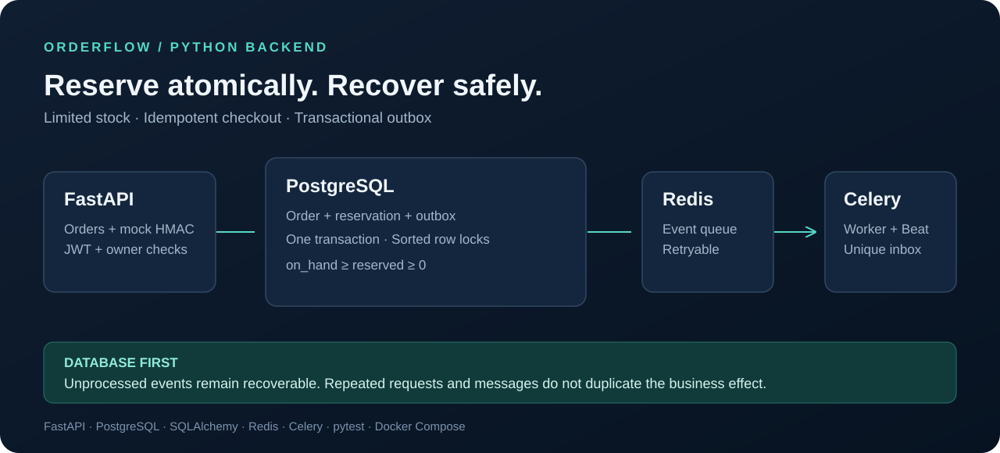

# OrderFlow

**Transactional checkout with limited stock, idempotent payments and recoverable background events.**

[](https://github.com/Sasambatra/orderflow/actions/workflows/ci.yml)
[](pyproject.toml)
[](LICENSE)

[Русский](README.md) · **English** · [Architecture](docs/architecture.en.md) · [Demo](docs/demo.en.md) · [Benchmarks](docs/benchmarks.en.md) · [Verification](docs/verification.en.md) · [Releases](https://github.com/Sasambatra/orderflow/releases)



## The problem

Two buyers can see the same final unit. A client can retry after losing a successful response. A payment provider can send the same event twice, or report success after a reservation has expired. The broker can fail after the database commits.

OrderFlow handles these cases explicitly. PostgreSQL owns the business state; retries and recovery are part of the implementation.

**Stack:** Python 3.13/3.14, FastAPI, SQLAlchemy, psycopg 3, PostgreSQL 18, Alembic, Redis 8, Celery, pytest, Docker Compose.

## Engineering decisions and evidence

| Problem | Implementation | Reproducible evidence |
| --- | --- | --- |
| Overselling the last unit | Sorted row locks, atomic multi-item reservation, database constraints | [20 buyers / one unit](tests/concurrency/test_races.py) → one `201`, nineteen `409` |
| Retried checkout | Persisted response and canonical payload hash, scoped UUIDv4 key | [20 identical retries](tests/concurrency/test_races.py) → one order |
| Duplicate or late payment | Signed raw-body webhook, persisted event deduplication, separate provider/application statuses | [Payment scenarios](tests/integration/test_payments.py) |
| Broker outage | Transactional outbox, leased dispatch, consumer deduplication | [Real Redis outage and recovery](tests/e2e/test_redis_recovery.py) |
| Payment versus expiration | Lock the order, then read the current database clock | [Lock-wait and race tests](tests/concurrency/test_races.py) |
| Unauthorised access | Argon2, short-lived JWTs, revocable sessions, owner/admin checks | [HTTP access tests](tests/integration/test_api.py) |

The local verification baseline is **65 passing tests on Python 3.13 and 3.14, with 93.04% combined statement/branch coverage**. The [verification report](docs/verification.en.md) records conditions and the live CI badge reports the current default branch.

## Run in a few minutes

Requires Git, Python 3 and Docker Compose with access to Docker Engine. Linux, macOS or Windows with WSL are suitable development environments.

```bash
git clone https://github.com/Sasambatra/orderflow.git
cd orderflow
python3 scripts/setup_env.py
docker compose up -d --build --wait api worker beat
docker compose exec -T api orderflow seed
docker compose exec -T api python scripts/demo.py
```

Open **http://localhost:8001/docs** for Swagger. `/health/ready` checks the database and migration revision. Register a user, log in, then paste the access token into **Authorize**.

The setup script creates independent random development secrets and preserves an existing `.env`. Seed creates three products and random demo credentials in the API's private volume. It preserves existing passwords and stock.

The demo checks checkout, response replay, signed mock payment, webhook replay and delivery through the real worker. See the [walkthrough](docs/demo.en.md) for output and a five-minute review route.

```bash
docker compose logs -f api worker beat
docker compose exec -T api orderflow outbox-status
docker compose down
```

Normal shutdown preserves volumes. Host ports bind to loopback: API `8001`, PostgreSQL `5433`, Redis `6380`. Stop conflicting local services first.

## API contract

Routes use `/api/v1`. Write operations require a UUIDv4 `Idempotency-Key`; retry the same operation with the original key. Changed payloads with the same key receive `409`. Replayed responses include `Idempotency-Replayed: true`.

| Area | Endpoints |
| --- | --- |
| Authentication | `POST /auth/register`, `/auth/login`, `/auth/logout`; `GET /auth/me` |
| Catalog | `GET /products`, `/products/{id}` |
| Orders | `POST /orders`; `GET /orders`, `/orders/{id}`; `POST /orders/{id}/cancel` |
| Payments | `POST/GET /orders/{id}/payments`; `POST /webhooks/mock-payments` |
| Inbox | `GET /notifications` |
| Administration | Product/stock changes, order/refund visibility, dead-event repair |

Lists use bounded cursor pagination. Prices are integer RUB minor units; order lines preserve product/price snapshots. Reservations last 15 minutes by default. All timestamps are timezone-aware UTC.

Webhook authentication uses `HMAC-SHA256(secret, timestamp + "." + raw_body)`, `X-Mock-Timestamp` and `X-Mock-Signature`. Amount, currency and order are validated after authentication. The [demo script](scripts/demo.py) is a complete client example.

## Development and checks

With Python 3.13/3.14, PostgreSQL and Redis running locally:

```bash
make setup
# Configure DATABASE_URL and a dedicated TEST_DATABASE_URL in .env.
make migrate
make seed
make run
# In two other terminals: make worker; make beat
make check
make test-e2e
```

The [runbook](docs/runbook.en.md) covers database creation, configuration, local process management, backup/restore and recovery. Tests refuse to truncate databases whose names do not end in `_test`. E2E uses and clears **Redis DB 15**; reserve it for these tests. A private `redis-server` executable is needed for the broker-stop scenario.

Entire container test suite:

```bash
docker compose --profile test run --build --rm tests
```

CI tests Python 3.13 and 3.14 against PostgreSQL/Redis, builds the Python distribution, and separately builds and exercises the Docker stack. Dependencies are hash-locked. Coverage XML and test reports are attached to workflow runs.

```bash
make benchmark             # 20 concurrent HTTP buyers, one unit
make build-python          # wheel and source archive
make build                 # also build the runtime container
```

[Measured load results](docs/benchmarks.en.md) separate correctness from capacity: three runs each at concurrency 20 and 50, 500 writes and 500 reads per run. They document latency, response counts, memory sampling, source revision and SQL invariants. Local loopback results are not a production SLA.

## Repository map

```text
src/orderflow/
  api/          HTTP routes and access dependencies
  core/         settings, security, pagination, logs, metrics
  db/           engine/session management
  models/       constrained PostgreSQL entities
  schemas/      strict request contracts
  services/     transactional business logic
  workers/      Celery tasks and schedule
  cli.py        development and maintenance commands
migrations/     reviewed Alembic schema and rollback
tests/          unit, integration, concurrency and real-process e2e
scripts/        setup, demos, local processes, load generator
docs/           design, runbook, results and portfolio notes
```

## Scope

This is a backend portfolio project with one warehouse, RUB, a **mock payment provider** and a database inbox. It does not transfer money, submit bank refunds or send external email/SMS. `refund_required` preserves a successful payment that could not be applied to an order for operator review.

A public deployment additionally needs TLS/reverse proxy, account recovery/email verification, a real provider and refund workflow, and operational monitoring/backups in the target environment. Process-local Prometheus counters assume one API process. Run one Celery Beat instance; event consumers safely accept repeated delivery.

Maintained by [Sasambatra](https://github.com/Sasambatra). [Contributing](CONTRIBUTING.md) · [Security](SECURITY.md) · [Changelog](CHANGELOG.md) · [MIT](LICENSE)
