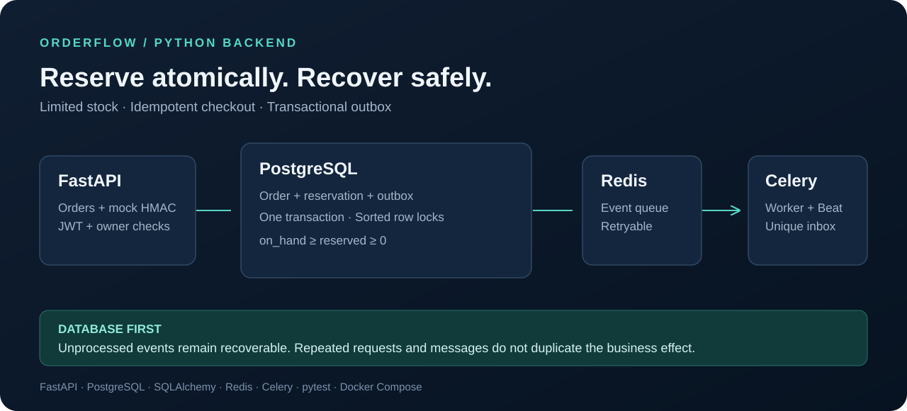

# OrderFlow

Backend заказов с ограниченными остатками, резервированием и обработкой повторных платежных событий.
Проект показывает работу с транзакциями, блокировками, идемпотентностью и восстановлением фоновых задач.

**Python 3.13 / 3.14 · FastAPI · PostgreSQL 18 · SQLAlchemy · Alembic · Redis · Celery · pytest**

**Русский** · [English](README.en.md) · [Архитектура](docs/architecture.ru.md) · [Демонстрация](docs/demo.md) · [Документация RU / EN](docs/README.md) · [Запуск](docs/runbook.ru.md) · [Проверки](docs/verification.ru.md) · [Для резюме](docs/portfolio.ru.md) · [Руководство по реализации](IMPLEMENTATION_GUIDE.ru.md)

[](https://github.com/Sasambatra/orderflow/actions/workflows/ci.yml)



## Задача и проверяемый результат

Два покупателя могут одновременно выбрать последнюю единицу товара. Клиент может
повторить запрос после потери ответа, а платёжное событие — прийти дважды или
после истечения резерва. PostgreSQL хранит итог операции; очередь доставляет
сохранённые события после восстановления.

| Сценарий | Решение | Свидетельство |
| --- | --- | --- |
| 20 покупателей на одну единицу | Транзакция, упорядоченные блокировки, ограничения БД | [Один `201`, девятнадцать `409`](tests/concurrency/test_races.py) |
| 20 повторов одного запроса | Сохранённый ответ и хеш тела запроса | [Один заказ, 19 повторных ответов](tests/concurrency/test_races.py) |
| Дубли и запоздавшая оплата | HMAC, дедупликация событий, отдельные состояния провайдера и заказа | [Платёжные сценарии](tests/integration/test_payments.py) |
| Сбой Redis | Transactional outbox и идемпотентный consumer | [Остановка брокера и восстановление](tests/e2e/test_redis_recovery.py) |

Зафиксированный результат: **65 тестов** на Python 3.13 и 3.14, **93,04%**
покрытия операторов и ветвей. Это результаты указанного в
[отчёте](docs/verification.ru.md) запуска; актуальный статус ветки показывает CI.

## Возможности

- Заказ и резерв всех позиций создаются одной транзакцией. Если одной позиции не хватает, изменений нет.
- Цена и название товара сохраняются в заказе; изменение каталога не меняет его сумму.
- Повтор с тем же `Idempotency-Key` возвращает прежний ответ. Другое тело с тем же ключом получает `409`.
- Подписанные HMAC события тестовой оплаты проверяются по сумме, валюте, заказу и времени подписи.
- Отмена и истечение срока освобождают резерв. Поздняя и дополнительная успешная оплата получают `refund_required`.
- Transactional outbox восстанавливает доставку событий после сбоя брокера; уведомления попадают в локальный inbox.
- Роли customer/admin, проверка владельца ресурса и JWT-сессии с отзывом при выходе.
- Управление каталогом и остатками, список заказов и проблемных оплат, повтор обработки dead events.

Оплата — **имитатор**: реальные деньги и банковские возвраты не отправляются. Email/SMS и отдельный frontend в эту версию не входят.

## Быстрый запуск в Docker

Нужны Python для генерации `.env` и Docker Compose с доступом к Docker Engine.
В Windows удобно использовать терминал WSL внутри VS Code.

```bash
git clone https://github.com/Sasambatra/orderflow.git
cd orderflow
python3 scripts/setup_env.py
docker compose up -d --build --wait api worker beat
docker compose exec api orderflow seed
docker compose exec api python scripts/demo.py
```

Swagger: **http://localhost:8001/docs**. Готовность: `GET /health/ready`.
В Swagger зарегистрируйте свою учётную запись, войдите и вставьте access token в **Authorize**.
Для изменяющих запросов нужен UUIDv4 в заголовке `Idempotency-Key`; при повторе операции сохраняйте прежний ключ.

Демо-пароли генерируются случайно и сохраняются в `/app/.local/demo-credentials.json` внутри volume API.
Seed не сбрасывает существующие пароли и остатки. Секреты не попадают в Git.

```bash
docker compose logs -f api worker beat
docker compose exec api orderflow outbox-status
docker compose --profile test run --build --rm tests
docker compose down
```

Остановка сохраняет volumes. Не добавляйте `-v`, если данные нужны.
Порты публикуются только на `127.0.0.1`: API `8001`, PostgreSQL `5433`, Redis `6380`.
Перед Docker-запуском остановите другие процессы, занимающие эти порты.

## Разработка без контейнеров

Нужны Python 3.13/3.14, PostgreSQL и Redis. Укажите подключения в `.env`.
Для тестов создайте отдельную БД `orderflow_test`; тесты очищают только БД с суффиксом `_test`.
Подготовка БД описана в [инструкции запуска](docs/runbook.ru.md).

```bash
make setup
make migrate
make seed
make run
# В двух других терминалах:
make worker
make beat
```

В Linux/WSL вместо трёх терминалов можно использовать:

```bash
.venv/bin/python scripts/local_stack.py start
.venv/bin/python scripts/local_stack.py status
make demo
.venv/bin/python scripts/local_stack.py stop
```

Helper управляет API/worker/beat; PostgreSQL и Redis должны работать отдельно.
Первый `make setup` генерирует секреты автоматически, существующий `.env` сохраняется.

## Проверки

```bash
make check                 # Ruff, обычные тесты с покрытием, pip check, схема
make test-concurrency      # Конкурентные транзакции на PostgreSQL
make test-e2e              # Реальные Redis и процессы API/worker
make build-python          # wheel + sdist
make build                 # дополнительно Docker image
make benchmark             # 20 HTTP-запросов на последнюю единицу
```

E2e-проверка остановки брокера требует `redis-server` или переменную `REDIS_SERVER`.
Без него пропускается только этот сценарий; проверка отдельного Celery worker использует доступный брокер.
Redis DB **15** очищается e2e-тестами: не храните в ней другие данные.

В репозитории подготовлены CI для Python 3.13/3.14 и container smoke.
Фактически выполненные проверки и ограничения среды — в [отчёте](docs/verification.ru.md).
Результаты нагрузки — в [benchmarks](docs/benchmarks.md).

## API

Бизнес-маршруты начинаются с `/api/v1`. Полная схема — `/docs` и `/openapi.json`.

| Группа | Маршруты |
| --- | --- |
| Вход | `POST /auth/register`, `/auth/login`, `/auth/logout`; `GET /auth/me` |
| Каталог | `GET /products`, `/products/{id}` |
| Заказы | `POST /orders`, `GET /orders`, `/orders/{id}`, `POST /orders/{id}/cancel` |
| Оплата | `POST/GET /orders/{id}/payments`, `POST /webhooks/mock-payments` |
| Уведомления | `GET /notifications` |
| Управление | `POST /admin/products`, `PATCH /admin/products/{id}`, `POST /admin/products/{id}/stock-adjustments` |
| Операции | `GET /admin/orders`, `/admin/outbox/dead`, `POST /admin/outbox/{id}/retry` |
| Наблюдение | `/health/live`, `/health/ready`; `/metrics` с токеном admin |

Списки используют `limit` (1–100) и непрозрачный `cursor`. Чужой заказ возвращает `404`.
Суммы — целые копейки (`price_minor`, `total_minor`), валюта — RUB. Время — UTC.
Резерв по умолчанию действует 15 минут.

Пример тела заказа:

```json
{"items": [{"product_id": "UUID из каталога", "quantity": 1}]}
```

Подпись mock webhook: `HMAC-SHA256(secret, timestamp + "." + raw_body)`.
Заголовки: `X-Mock-Timestamp` и `X-Mock-Signature`. Рабочий пример — `scripts/demo.py`.
Повтор старого события подписывается свежим timestamp; исходные event_id и тело сохраняются.

## Структура

| Путь | Назначение |
| --- | --- |
| `src/orderflow/api` | HTTP, авторизация, обязательный ключ запроса |
| `src/orderflow/core` | Настройки, JWT/HMAC/Argon2, логи, метрики, cursors |
| `src/orderflow/db`, `models` | PostgreSQL-сессии и ORM-сущности с ограничениями |
| `src/orderflow/schemas` | Строгие входные контракты Pydantic |
| `src/orderflow/services` | Заказы, платежи, outbox, inbox, каталог и auth |
| `src/orderflow/workers` | Celery app и фоновые задачи |
| `src/orderflow/cli.py` | Seed, создание admin, expire/relay, outbox |
| `migrations` | Начальная миграция Alembic и обратный откат |
| `tests` | Unit, интеграционные, конкурентные и e2e-проверки |
| `scripts` | Настройка, локальные процессы, HTTP-демо и нагрузка |
| `docs` | Архитектура, эксплуатация, результаты, портфолио |
| `.github/workflows` | CI с PostgreSQL/Redis и отдельной сборкой контейнера |

Зависимости закреплены с хешами в `requirements.lock` и `requirements-dev.lock`.
Обновление: `uv pip compile pyproject.toml --python-version 3.13 --generate-hashes -o requirements.lock`; для dev добавить `--extra dev` и изменить выходной файл.

## Границы версии

Это законченный учебный backend для портфолио: один склад, RUB, mock-провайдер и локальный inbox.
Для публичного сервиса нужны TLS/reverse proxy, восстановление доступа и подтверждение email, реальный провайдер и процедуры возврата, мониторинг и резервное копирование в целевой среде.
Процессные Prometheus counters рассчитаны на один API-процесс; между несколькими экземплярами они автоматически не объединяются.
Celery Beat запускается в одном экземпляре. Повторная обработка фоновых событий безопасна.

Лицензия: [MIT](LICENSE).
