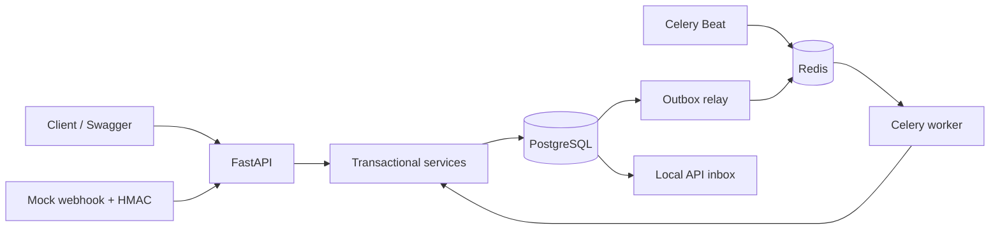
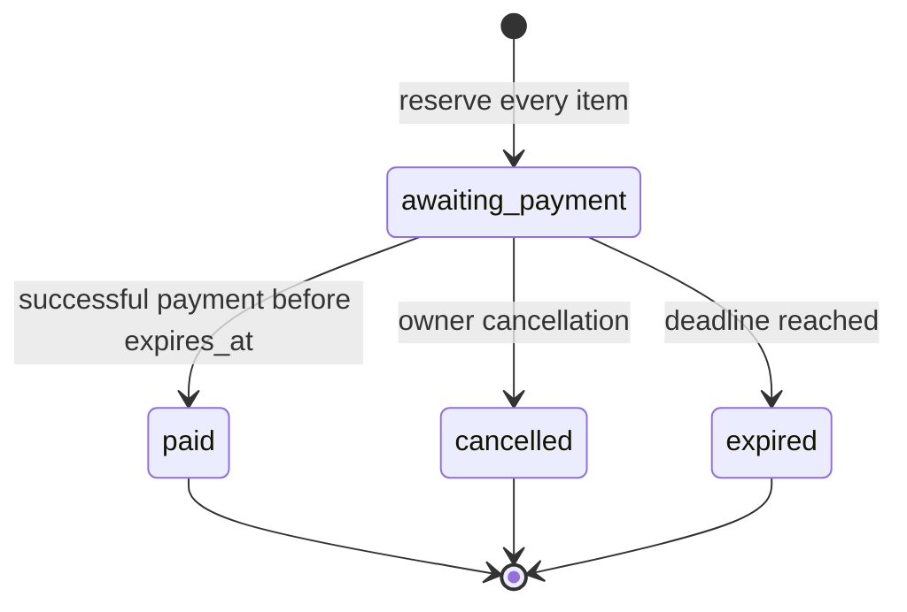

# OrderFlow architecture

[Русский](architecture.ru.md) · **English**

## Components

A modular monolith: HTTP and Celery share transactional services and SQLAlchemy
models. Synchronous FastAPI routes run in a thread pool; a Session is never shared
across requests or threads. PostgreSQL uses psycopg 3. Integration tests do not
substitute SQLite for PostgreSQL.

## Orders and stock

`available = on_hand - reserved` is calculated on reads. Three CHECK constraints
enforce `on_hand >= reserved >= 0`. Checkout increases `reserved`; payment reduces
both counters; cancellation/expiration reduces only `reserved`. A reservation
leaves `active` for `consumed` or `released` once. Money is integer RUB minor units;
timestamps are timezone-aware UTC.

Checkout locks Product and Inventory in UUID order and checks every item before
changing counters. Existing-order operations lock Order, then Inventory in UUID
order, then Payment. Creating a payment does not change Inventory. Administrative
stock changes use the same Product/Inventory lock order.

The deadline is checked using `clock_timestamp()` after taking the Order lock.
Waiting for a lock therefore cannot reuse a stale transaction-start `now()`.
Delayed expiration jobs may keep stock conservatively reserved, but cannot make
a late payment valid.

History and outbox records commit with the business operation, before its HTTP
response. Lock/serialization errors retry at most three times in fresh
transactions. Unexpected failures roll back the business state and new request key.

## Idempotency

Keys are scoped to `(actor_id, method, path, UUIDv4)`. Canonical JSON hashing ignores
order-line ordering. `INSERT ... ON CONFLICT` and a unique index serialize concurrent
requests sharing a key. The record and business changes share one transaction.
A SAVEPOINT preserves expected business failures (`409`) without partial stock changes.

The full response is stored: retries return its original status/body plus
`Idempotency-Replayed: true`. A stored error retains the first request's `request_id`;
`X-Request-ID` identifies the current HTTP request. A changed payload conflicts.
Changed business conditions require a new key. Version 1 has no automatic key expiry.

## Payment events

HMAC-SHA256 authenticates the original bytes, with a default 300-second timestamp
window and a 64 KiB body limit even without Content-Length. Authenticated events
must match payment/order IDs, amount, and currency. Each `(provider, event_id)`
maps to one raw-body hash; another event ID cannot consume stock a second time.

| Situation | provider_status | application_status |
| --- | --- | --- |
| New attempt | pending | not_applied |
| First success before the deadline | succeeded | applied |
| Success after cancellation/expiry, or another success | succeeded | refund_required |
| Failure before any success | failed | not_applied |

A late failure never regresses `succeeded`. Success after failure still checks
the deadline. A partial unique index permits only one applied payment per order.
`refunded` is reserved for a future refund workflow; no bank refund is performed.

## Event delivery

The relay claims outbox batches with `FOR UPDATE SKIP LOCKED`, assigns a lease
token, then publishes outside the transaction. An old relay cannot complete
another owner's lease. `published_at` does not mean completed: publication repeats
until the consumer commits `processed_at`.

The consumer locks the outbox row, inserts a Notification with unique
`(event_id, channel)`, and records completion in one transaction. A crash before
commit allows retry; a crash after commit but before ACK cannot create a second
local inbox notification. External email would require its own provider protocol.

Transport attempts and processing attempts are separate. Redis outages alone do
not exhaust an event's processing budget. Five processing failures mark it dead;
an operator fixes the cause before retrying.

## Security and trade-offs

- Passwords use Argon2. HS256 JWTs validate issuer, audience, expiry, and a revocable server session.
- Catalog management checks admin access in dependencies and services.
- Another owner's order appears missing (`404`). Strict input models reject extra fields and client-assigned roles/prices/states.
- Logs omit request bodies and Authorization. Validation errors omit original field values.
- Redis limits login/registration by connection address. These return `503` during an outage; existing tokens and checkout still work.
- TLS, network timeouts, and trusted proxies require the target deployment's reverse proxy.
- Refresh, password reset, and email verification are outside this version. PostgreSQL remains authoritative.

Database queries live in services. A pass-through repository layer would duplicate
SQLAlchemy calls without adding behavior at this scale.
