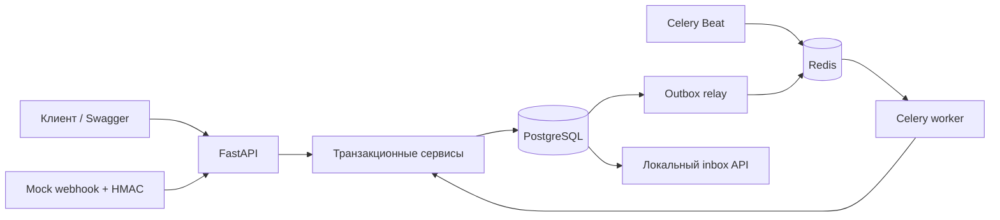
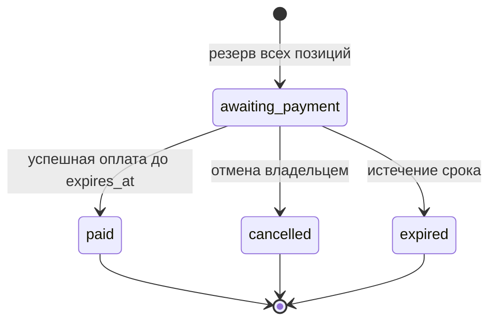

# Архитектура OrderFlow

**Русский** · [English](architecture.en.md)

## Компоненты

Модульный монолит: HTTP и Celery используют одни сервисы и SQLAlchemy-модели.
Синхронные маршруты FastAPI выполняются в thread pool; Session не разделяется между запросами или потоками.
Драйвер PostgreSQL — psycopg 3. SQLite не участвует в интеграционных тестах.

## Заказ и остатки

`available = on_hand - reserved` вычисляется при чтении. Три CHECK-ограничения гарантируют
`on_hand >= reserved >= 0`. Создание заказа увеличивает reserved; оплата уменьшает и on_hand,
и reserved; отмена/истечение уменьшают только reserved. Резерв переходит из active
в consumed или released один раз. Цены — целые копейки, дата — timezone-aware UTC.

Создание заказа блокирует Product и Inventory в порядке UUID. Проверка всех позиций
предшествует изменению счётчиков. Операции существующего заказа сначала блокируют Order,
затем Inventory в порядке UUID, затем Payment. При создании платежа Inventory не меняется.
Административная корректировка блокирует Product и Inventory в том же порядке.

Время проверяется через `clock_timestamp()` после захвата Order, поэтому ожидание
блокировки не позволяет использовать устаревшее транзакционное `now()`.
Проверка срока является частью решения под блокировкой заказа. Если expire-задача
задержалась, stock может консервативно оставаться зарезервированным, но поздняя оплата запрещена.

История версий и outbox сохраняются вместе с бизнес-операцией. Выход из transaction context
предшествует возврату HTTP-ответа. Ошибки блокировки/serialization повторяются максимум трижды
в новых транзакциях. Неожиданные ошибки откатывают и бизнес-данные, и новый ключ запроса.

## Идемпотентность

Область ключа: `(actor_id, method, path, UUIDv4)`. Хеш строится по каноническому JSON;
порядок позиций заказа не влияет на него. `INSERT ... ON CONFLICT` и уникальный индекс
сериализуют одновременные запросы с одним ключом.

Новая запись и бизнес-изменения находятся в общей транзакции. SAVEPOINT позволяет
сохранить ожидаемый бизнес-отказ (`409`) без частичного резерва. Ответ хранится полностью:
повтор возвращает прежние status/body и `Idempotency-Replayed: true`.
Если ранее сохранена ошибка, её `request_id` относится к первому запросу;
заголовок `X-Request-ID` идентифицирует текущий HTTP-запрос.

Для повторной попытки после изменения бизнес-условий нужен новый ключ.
Записи не удаляются автоматически: в v1 нет срока, после которого старый ключ можно использовать заново.

## Платёжные события

HMAC-SHA256 проверяется по исходным байтам; окно timestamp по умолчанию 300 секунд.
Тело ограничено 64 KiB даже без Content-Length. Подписанное событие также проверяется
по payment/order ID, сумме и валюте. Один `(provider, event_id)` соответствует одному raw-body hash.
Другой event_id для того же платежа не означает повторного списания товара.

Статус провайдера отделён от применения платежа к заказу:

| Ситуация | provider_status | application_status |
| --- | --- | --- |
| Новая попытка | pending | not_applied |
| Успех до срока и первый платёж заказа | succeeded | applied |
| Успех после отмены/истечения или второй успех | succeeded | refund_required |
| Ошибка до успешного события | failed | not_applied |

Поздний failure не регрессирует succeeded. Более поздний success после failure
обрабатывается обычным правилом срока. Частичный уникальный индекс разрешает
только один applied-платёж заказа. `refunded` зарезервирован в модели для будущего
процесса возврата; банковского возврата в текущем сервисе нет.

## Доставка событий

Relay захватывает пачку outbox через `FOR UPDATE SKIP LOCKED`, выдаёт lease token
и публикует вне транзакции. Старый relay не может завершить чужую lease.
`published_at` не является признаком завершения: событие повторно отправляется,
пока consumer не зафиксирует `processed_at`.

Consumer блокирует строку outbox, вставляет Notification с уникальным `(event_id, channel)`
и отмечает обработку в общей транзакции. Сбой до commit допускает повтор; сбой после
commit до ACK не создаёт второго уведомления. Такая гарантия относится к локальному
inbox. Для внешней почты понадобился бы idempotency API провайдера или иной протокол.

Transport attempts и processing attempts разделены. Недоступный Redis не отправляет
события в dead-letter по одному лишь числу попыток публикации. Пять ошибок обработки
помечают событие dead; оператор исправляет причину и запускает retry.

## Безопасность и компромиссы

- Argon2 для паролей, JWT HS256 с issuer/audience/expiry и серверной отзывной сессией.
- Только admin-зависимость допускает управление каталогом; сервисы также проверяют роль.
- Чужой заказ возвращает 404. Входные модели запрещают лишние поля и назначение роли/цены/статуса клиентом.
- Логи не содержат тело запроса и Authorization. Validation errors не возвращают исходные значения полей.
- Redis ограничивает частоту login/register по адресу подключения; при его сбое эти операции возвращают 503.
- Уже выданный токен и создание заказов продолжают работать при сбое Redis.
- Для TLS, request timeout на уровне сети и trusted proxy нужен reverse proxy целевой среды.
- Refresh/reset/email verification не входят в MVP. PostgreSQL остаётся источником истины.

Прямые запросы к БД сосредоточены в сервисах. Отдельный слой pass-through repositories
не добавлен: в этом масштабе он дублировал бы вызовы SQLAlchemy без дополнительного поведения.
